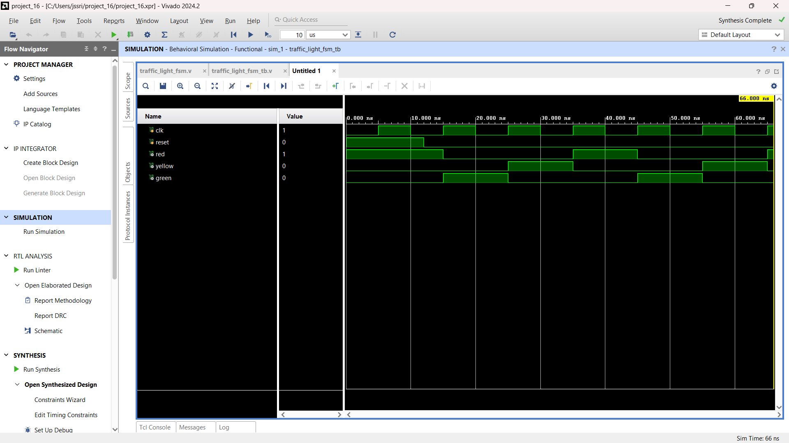
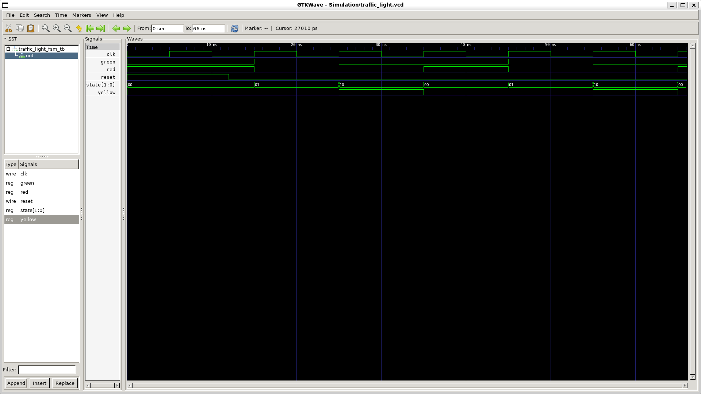
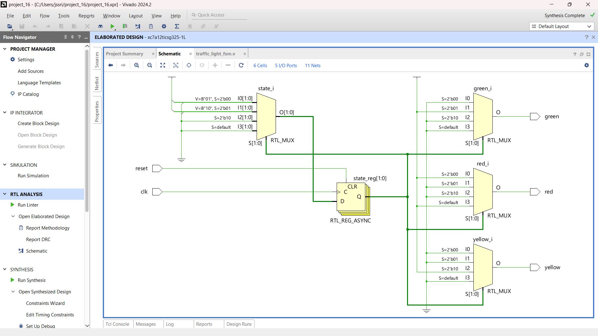

# FSM-Based Traffic Light Controller

## Project Overview
Designed and simulated a Finite State Machine (FSM)-based traffic light controller using Verilog HDL.

The controller cycles through three states: RED, GREEN, and YELLOW using clock-driven state transitions.

## Features
- Three-state FSM architecture
- Synchronous state transitions with asynchronous reset
- Independent RED, GREEN, and YELLOW outputs
- Verilog RTL design
- Functional simulation and waveform verification

## State Sequence

RED → GREEN → YELLOW → RED

## Tools Used
- Verilog HDL
- Xilinx Vivado 2024.2
- Icarus Verilog
- GTKWave
- Ubuntu

## Simulation Results

The simulation successfully verified the repeating traffic light sequence.

| State | RED | YELLOW | GREEN |
|---|---:|---:|---:|
| RED | 1 | 0 | 0 |
| GREEN | 0 | 0 | 1 |
| YELLOW | 0 | 1 | 0 |

**Simulation Status: TEST PASSED**

## Project Screenshots

### Vivado Simulation

### GTKWave Simulation

### RTL Schematic

## Project Structure

- `Verilog/` – FSM RTL source code
- `Testbench/` – Verilog testbench
- `Simulation/` – Simulation output and waveforms
- `RTL_Schematic/` – RTL schematic screenshot
- `Documentation/` – Project reference materials

## Project Type
Digital Design | Verilog HDL | Finite State Machine (FSM)
